<div align="center">

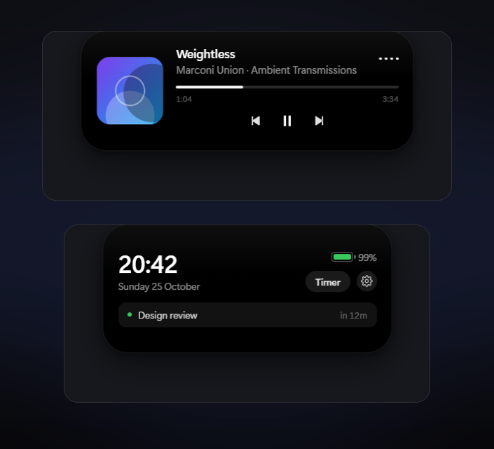

<h1>Dynamic Island for Windows</h1>

<p><b>The black capsule from your iPhone, living at the top of your Windows screen.</b><br>
Now playing, volume, timers, clipboard, calendar and live activities - in one
animated pill that never gets in the way.</p>

<p>
<a href="#requirements"></a>
<a href="LICENSE"></a>
<a href="https://github.com/commerce-students/dynamic-island/releases"></a>
<a href="https://github.com/commerce-students/dynamic-island/releases"></a>
<a href="https://github.com/commerce-students/dynamic-island/actions/workflows/ci.yml"></a>
</p>

<p>
<a href="#install">Download</a> &nbsp;·&nbsp;
<a href="#what-it-does">Features</a> &nbsp;·&nbsp;
<a href="#settings">Settings</a> &nbsp;·&nbsp;
<a href="#live-activities-api">API</a> &nbsp;·&nbsp;
<a href="#run-it-from-source">Build it yourself</a>
</p>

</div>

---

## Install

1. Grab **`Dynamic-Island-Setup-1.5.0.exe`** from the [latest release](https://github.com/commerce-students/dynamic-island/releases/latest).
2. Double-click it. That's the whole install - one click, no questions.
3. The island appears at the top of your screen and starts with Windows from
   then on.

> **Windows will warn you.** The installer is not code-signed (a certificate
> costs a few hundred dollars a year, which this project does not have). Click
> **More info → Run anyway**. That is the normal path for open-source Windows
> apps.

Everything installs into `Program Files`, appears in **Settings → Apps** like any
other program, and can be removed from there. To open the settings later, press
the Windows key and type **dynamic** - or right-click the island, or double-click
the tray icon.

## Requirements

- Windows 10 (1809 or newer) or Windows 11, 64-bit
- Nothing else. The installer carries its own Python runtime, so you do **not**
  need Node.js, Python or any package manager.

## What it does

| | |
|---|---|
|  | **Idle.** A tiny capsule with the clock. The dot glows green while audio plays, orange when your microphone or camera is live. |
| 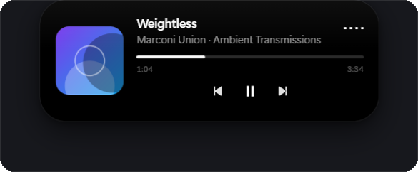 | **Now playing.** Artwork, title, artist, progress and transport controls. The equaliser follows the real audio level, not a fake animation. |
| 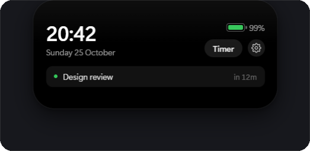 | **The panel.** Click the capsule: big clock, date, battery, next meeting, timer launcher, AI, settings. |
| 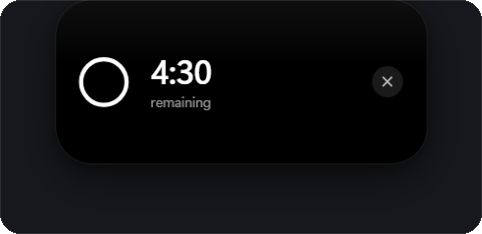 | **Timer.** 1 / 5 / 10 / 25 minutes, countdown ring, an alarm you choose, and confetti. |
| 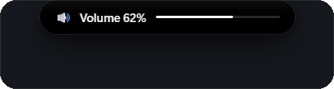 | **Volume.** A HUD with a real level meter whenever the volume changes. |
| 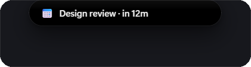 | **Calendar.** Counts down to your next meeting from a private iCal link. |
| 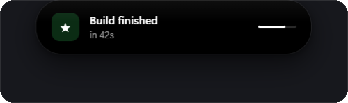 | **Live activities.** Any script can push a card - builds, downloads, CI, long jobs. |
| 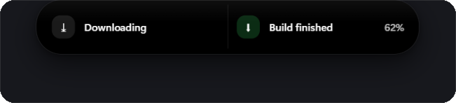 | **Two at once.** Apple splits the island when a second activity arrives; so does this. |
| 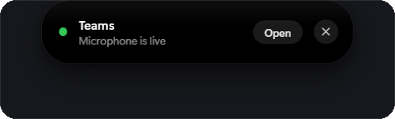 | **Call banner.** Appears while a call holds the microphone, with one button that jumps to the app. |
| 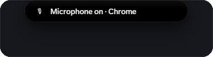 | **Microphone & camera.** Shows which app is recording, from the same source as the Windows privacy dot. |
| 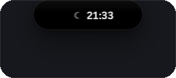 | **Focus Assist.** A moon in the idle pill while Do Not Disturb is on, plus a red dot while anything is recording the screen. |
| 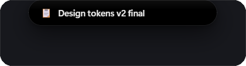 | **Clipboard.** A quiet confirmation when you copy something. Nothing is stored. |
| 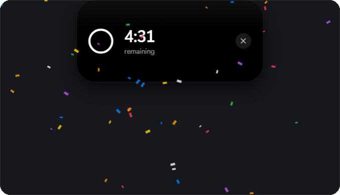 | **Confetti.** Because a finished timer deserves it. |
| 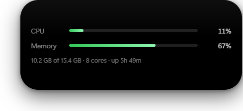 | **System stats.** Live CPU load and memory in the panel, read straight from Windows — no extra process. |

### AI assistant (optional)

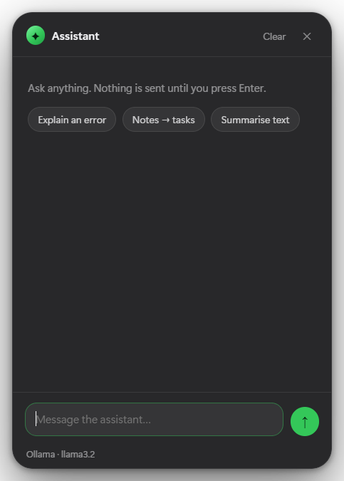

A `✦ AI` chip in the panel opens a small chat window under the island. It is
off until you turn it on, and it sends nothing until you press Enter.

- **Five providers**, chosen in Settings → AI. **Pollinations** works immediately with
  no signup and no key, **Groq** and **Google Gemini** each have a real free tier,
  **OpenAI** if you already pay for it, and **Ollama** runs entirely on your own
  machine with no key and no internet.
- **It degrades instead of dying.** If the free no-key service is busy, the app
  quietly asks your local Ollama before giving up.
- **Your key stays in the main process.** The chat window never sees it — the
  renderer asks the main process, which makes the request.
- **No key is bundled.** Every provider ties a key to your own account; the
  settings pane links straight to where you get one.
- **Cancellable and honest.** Timeouts, HTTP errors and explanations come back
  in the window — it never pretends an answer arrived.

### Timer alarm you choose

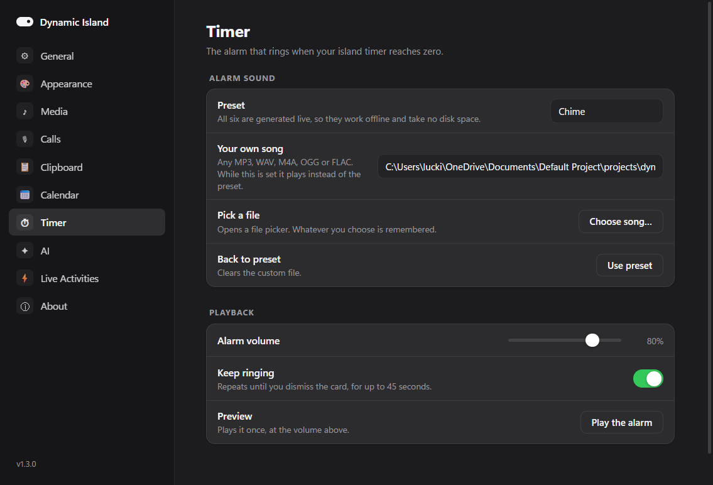

- Six built-in alarms — Chime, Bell, Marimba, Arcade, Digital, Soft — synthesised
  at play time, so they work offline and ship no audio files.
- Or **pick any song** on your PC: MP3, WAV, M4A, OGG, FLAC, OPUS. The path is
  remembered and played at the volume you set.
- It repeats until you dismiss the card (up to 45 seconds), and **Preview**
  plays exactly what you chose.


### The details

- **Spring physics.** Every shape change is integrated with a damped spring
  (stiffness 320, damping 30), so it settles like a physical object.
- **Liquid morph.** The capsule squashes and stretches while it changes size.
- **Click-through.** It ignores the mouse until you hover over it, so it never
  eats clicks meant for your browser.
- **Long press** opens the full card, single click opens the panel.
- **Tap to open.** Tapping a live activity raises the app that sent it, and
  tapping the album art raises your player - Apple's exact behaviour.
- **Three themes.** Pure black, tinted by the album art's dominant colour, or
  glass.
- **Real audio.** The bars are driven by Core Audio peak values at ~11 Hz.
- **Sound cues.** Tiny synthesised clicks - no audio files, no volume spikes.
- **Island size.** One slider scales the whole capsule - artwork, text and
  buttons together - from 75% to 140%.
- **No telemetry.** Nothing leaves the machine unless you press send in the AI
  window, and then only to the provider you picked. The calendar URL is stored
  locally and only that URL is fetched.

### What it deliberately does not pretend to do

- **Windows notifications in the island.** Windows only lets a *packaged*
  (MSIX/Store) app read other apps' notifications, and only after you grant
  permission in Settings → Privacy → Notifications. This is an ordinary
  desktop app, so instead it ships the [Live Activities API](#live-activities-api),
  which anything on your PC can push to - builds, downloads, scripts.
- **The Windows Clock app's timer and stopwatch.** That state lives inside the
  Clock app and Microsoft exposes no way to read it. The island has its own
  timer instead, and it rings with whatever sound you chose.
- **Answering calls.** Windows has no public API for accepting a call from a
  third-party app, so the call banner jumps to the app rather than offering a
  button that would do nothing.

## Settings

Everything is configurable from a real settings window - no config files to
edit, no restarts.

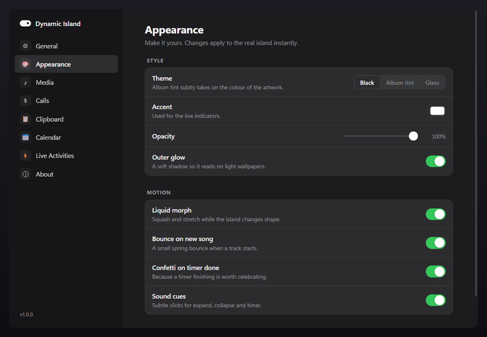

| Pane | What you can change |
|---|---|
| **General** | Position (top/bottom), display, hotkey, auto-collapse, start with Windows |
| **Appearance** | Theme, accent colour, opacity, **island size**, outer glow, liquid morph, bounce, confetti, sound cues |
| **Media** | Show artwork, ambient tint, now-playing behaviour |
| **Widgets** | CPU & memory card, refresh interval |
| **Calls** | Indicator for microphone and camera use, which apps count |
| **Clipboard** | Confirmation card on copy, length |
| **Calendar** | Your private iCal URL, how far ahead to warn you |
| **Timer** | Alarm preset or your own song, volume, repeat, preview |
| **AI** | On/off, provider, model, API key, test |
| **Live Activities** | Port, default duration, whether to play a sound |
| **About** | Version, settings file, app folder |

## Live Activities API

Anything that can send an HTTP request can use the island as a display:

```powershell
curl -X POST http://127.0.0.1:39321/push `
  -H "Content-Type: application/json" `
  -d '{"title":"Build finished","subtitle":"42s - 3 warnings","tone":"success","durationMs":8000}'
```

| Field | Type | Notes |
|---|---|---|
| `title` | string | required |
| `subtitle` | string | second line |
| `icon` | string | short text or glyph shown on the left |
| `progress` | number | `0`-`1`, draws a progress bar |
| `tone` | string | `info`, `success`, `warning`, `error` |
| `durationMs` | number | how long the card stays |
| `id` | string | push the same id again to update a card in place instead of adding one |
| `open` | string | what a tap opens: a URL, a file path, or a window title to raise |
| `layout` | object | Apple's ActivityKit regions, see below |

Push a second activity and the island splits in two, exactly like iOS. A third
one replaces the oldest.

```json
{
  "id": "build-42",
  "title": "Build finished",
  "tone": "success",
  "durationMs": 10000,
  "open": "https://github.com/commerce-students/dynamic-island/actions",
  "layout": {
    "compactLeading":  { "icon": "⚙" },
    "compactTrailing": { "text": "done" },
    "minimal":         { "icon": "⚙" },
    "expanded": {
      "leading":  { "icon": "⚙" },
      "trailing": { "text": "3 warnings" },
      "center":   { "title": "Build finished", "subtitle": "main · 42s" },
      "bottom":   { "text": "3 warnings, 0 errors" }
    }
  }
}
```

Every region is optional - the flat `title` / `subtitle` / `icon` fields are used
as a fallback, so the one-line example above still works.

`POST /clear` dismisses every card. `GET /health` answers `{"ok":true}` when the
island is running. The server binds to `127.0.0.1` only - it is not reachable
from your network.

### What the endpoint refuses

The port is open to every process on your PC, and to every web page you have
open. Three rules keep browsers out without getting in the way of scripts:

| Rule | Result |
|---|---|
| `POST` without `Content-Type: application/json` | `415` - a cross-origin page cannot set that header |
| A request carrying an `Origin` header | `403` - unless you tick **Allow web pages** in Settings → Live Activities |
| More than 30 pushes a minute | `429` - a runaway loop cannot drown the island |
| A body over 16 KB | `413` |

Bodies with a UTF-8 BOM are accepted, because PowerShell writes one by default.

## Privacy

- The island reads **metadata only**: the title/artist Windows publishes for the
  current media session, the master volume, and the microphone/camera "in use"
  registry keys that Windows itself maintains.
- It never records audio, never reads clipboard history, and never keeps copied
  text.
- The only automatic outbound request is the calendar URL you paste in yourself.
  If you switch the assistant on, a message you send goes to the provider you
  picked (and to nowhere else). With **Ollama** nothing leaves the machine.
- **No window ever receives your API key.** It lives in the main process, is
  replaced by `hasApiKey: true` before any window sees the settings, and is only
  used in the request to the provider you chose.
- No accounts, no analytics, no update pings.

## Security

The app is built to the Electron checklist rather than around it:

- `contextIsolation: true`, `nodeIntegration: false` and `sandbox: true` on every
  window; each preload exposes a named, minimal API instead of `ipcRenderer`.
- Windows only ever load local files. Navigation away from them is blocked,
  popups are denied, and http(s) links are handed to your real browser.
- Every permission request (microphone, camera, screen, notifications) is denied:
  the app has no feature that needs one.
- Settings changes and AI calls are only accepted from the app's own three
  windows, checked by `webContents` id, not by anything inside the payload.
- The settings merge refuses `__proto__`, `constructor` and `prototype`, so a
  crafted patch cannot pollute `Object.prototype`.
- A tap on a Live Activity can open `http(s):`, `mailto:` or a real path. Every
  other protocol handler is ignored.
- `npm test` covers the network boundary and the merge: 24 tests, no test
  framework, no dependencies.

Details and the remaining hardening work are in [`docs/audit.md`](docs/audit.md).

## Run it from source

```powershell
git clone https://github.com/commerce-students/dynamic-island.git
cd dynamic-island
npm install
pip install -r requirements.txt
npm start
```

## Build the installer

```powershell
npm run dist        # -> release\Dynamic-Island-Setup-<version>.exe
```

The build first assembles a private Python runtime into `runtime/` (portable
CPython + the two sidecar scripts), then packages everything with
electron-builder. [`.github/workflows/release.yml`](.github/workflows/release.yml)
does the same on GitHub Actions: publish a release and the installer is attached
to it automatically.

## How it works

```
Electron (main)  ──┬── bridge.py   WinRT: media sessions, mic/camera, calls
                   ├── volume.py   Core Audio: volume + peak levels
                   └── renderer    the capsule (spring physics, canvas, WebAudio)
```

The two Python sidecars are separate processes on purpose: `pycaw`/`comtypes`
initialise COM in a way that clashes with the WinRT apartment the media bridge
needs. Album-art colours are decoded in the main process, because a `file://`
canvas cannot read pixels back without tainting.

More in [CONTRIBUTING.md](CONTRIBUTING.md).

## Troubleshooting

| Problem | Fix |
|---|---|
| Windows shows a blue "protected your PC" screen | **More info → Run anyway**. The installer is unsigned. |
| The island is invisible | It may be hidden. Press `Ctrl+Alt+D` or use the tray icon. |
| No album art in the browser | Chromium does not publish artwork to the media session. Real players (Spotify, iTunes, Windows Media Player) do. |
| Mic/camera never lights up | Only apps that go through the Windows privacy layer are reported. |
| Calendar shows nothing | Use the **secret iCal address** from Google Calendar → Settings → *Secret address in iCal format*. |

## Contributing

Issues and pull requests are welcome - see [CONTRIBUTING.md](CONTRIBUTING.md).

## License

[MIT](LICENSE) © 2026 Lucki

## Disclaimer

This is a fan project. It is not made by, endorsed by, or affiliated with Apple
Inc. "Dynamic Island" is Apple's name for a feature of the iPhone; this is an
independent Windows interpretation, written from scratch with no Apple code,
assets or artwork. If Apple asks for the name to change, it will change.
